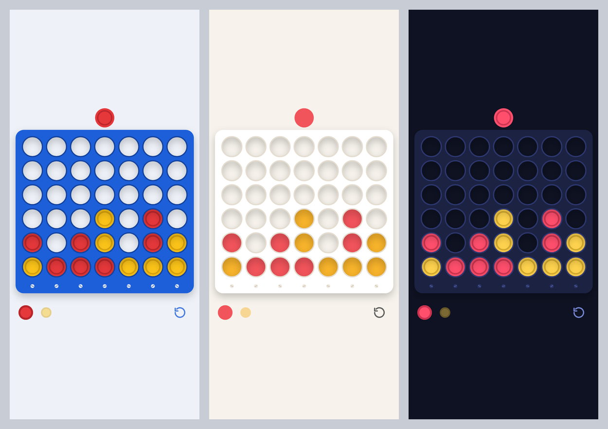

# Connect 4 — the magician never loses

A normal-looking Connect 4 page for two players on one device. The spectator
plays yellow; the magician plays red and **always goes first**. After every
spectator move the page secretly shows the magician the column that wins.

Open `index.html` (works offline, straight from the file, or on GitHub Pages).

Controls: press on the board to pick up the disc, slide it to a column (that
column is softly highlighted) and let go to drop it; a quick tap drops it
straight in. Below the board: whose turn it is, **undo** (takes back one
move) and **new game**.

## The maths

Connect 4 (7 × 6) is a solved game: James D. Allen and Victor Allis
independently proved in 1988 that **the first player wins with perfect play
by starting in the centre column**. Starting anywhere else lets a perfect
opponent draw (columns 3 or 5) or win (columns 1, 2, 6, 7).

So the magician:

1. always plays first,
2. always opens in the centre,
3. then plays the column the page signals.

Against any spectator, that line is a forced win. Among winning moves the
page always picks the **fastest** one, so games against weak play end quickly.

## The secret signal

Pick the tell with a URL parameter (it is remembered on that device, so the
address bar stays clean afterwards):

| `?tell=` | What the magician looks for |
|---|---|
| `rest` | On red's turn the floating red disc above the board settles over the winning column. On touch screens it just sits there; with a mouse, move the pointer off the board to see it. |
| `screw` | The seven little screws on the bottom rail have slanted slots. The screw under the winning column has its slot **vertical** (`|`). |
| `shade` *(default)* | The next empty hole in the winning column loses its dark rim, so it looks a touch bigger and lighter. |
| `off` | No signal (plain game). |

Nothing is shown during the spectator's turn.

## Audio mode (Apple Watch)

For performing without seeing the board: the spectator holds the phone away
from you and plays both colours, dropping red wherever you call it. The phone
"plays" a silent track, and the track title, which your Apple Watch shows in
**Now Playing**, carries the signal:

| Watch shows | Meaning |
|---|---|
| `—` | Spectator's turn, wait |
| `1`–`7` | Call this column for red |
| `Win` / `Lost` / `Draw` | Game over |

- **Switch on/off:** tap the small **123** button below the board. The
  numbers 1–7 appear above the columns, the on-board signal is turned off,
  and the silent track starts. The phone remembers the mode, so after
  reopening the page, tap anywhere once to restart the track (iPhone only
  starts audio from a tap).
- **Use a normal Safari tab, not Private Browsing.** In private tabs Safari
  deliberately blanks everything on Now Playing (title, artwork, even the
  site name), so the watch shows only the play controls.
- Only the track title changes. The album-art square stays plain black.
- **Before handing over:** check that your watch shows `—` or a number in
  Now Playing. Turning on *Auto-Launch Audio Apps* on the watch
  (Watch app → General → Auto-Launch) makes Now Playing open by itself.
- The track is pure silence, so nothing is heard, but it does take over
  audio: stop any music first. Pause on the watch is ignored so the signal
  can't be stopped by accident; switch the mode off on the phone instead.
- Your first move is always the centre (`4`).

## Sound and the chime prediction (two phones)

The speaker button next to the turn discs turns game sounds on or off: a soft
tick as the disc slides between columns, a clack when it lands, and a
winning chime at the end of every game. Mute only affects these sounds; audio
mode's silent watch track keeps playing.

The chime secretly carries the exact final board. A second phone running
the same page can hear it and copy that board:

1. **Prediction phone:** open the page and play a "prediction game" alone.
   Then **press and hold the restart button for about a second** and let go.
   Allow the microphone the first time. When it's listening, the turn
   indicator flips to the other colour (red's turn shows yellow). If the turn
   discs blink twice instead, listening couldn't start: check the microphone
   permission (Settings → Safari → Microphone, or the "aA" menu → Website
   Settings) and that the page is opened over https. Holding restart again
   stops listening. Put the phone face down. It keeps the
   screen awake, and it must stay on this page.
2. **Game phone** (borrowed, sound on, volume up): the spectator plays a game.
   When it ends, "Red wins" (or "Yellow wins") pops up with confetti and the chime plays.
3. The prediction phone hears the chime, stops listening and shows that
   exact final board as if its prediction game had ended that way, with the
   winning four highlighted. Turn it over.

If the chime wasn't heard (too noisy, volume too low), tap the finished board
on the game phone to play it again.

How it works: the board fits in 49 bits, plus an 11-bit check, sent as 20
quick notes from eight pitches within one octave (so no note is an overtone
of another) after a two-note "ta-da" that marks the start. The listener
checks the code and that the board is a legal finished game before
accepting it. In simulation (echoey rooms, noise louder than the chime,
background music) it decoded every board correctly, with no false alarms.
iPhone shows an orange microphone dot while listening.

Themes: `?theme=classic` (default, blue board), `?theme=flat`, `?theme=night`.



Example: `index.html?theme=classic&tell=screw`

## How it works

- `solver/solver.c` — a perfect solver (negamax + alpha-beta over bitboards,
  null-window search, threat-based move ordering, transposition table). It
  returns the exact score of a position, i.e. win/draw/loss *and* how soon.
  It is freestanding C, compiled natively for tooling and to WebAssembly
  (~4 KB) for the page, where it runs in a Web Worker.
- `solver/gen.c` — walks the magician's strategy tree (magician's best move,
  every possible spectator reply) and records the best move for every
  magician turn up to ply 12. Early positions are the expensive ones (tens of
  seconds each), so they are precomputed; the page embeds this opening book.
  Beyond the book the live solver answers in milliseconds.
- `solver/sim.c` — plays thousands of games (random, "smart" and perfect-
  resistance spectators) to check the magician never fails to win.
- `solver/brute.c` — independent brute-force check of solver scores.
- `solver/book12/` — the generated opening book (36,032 magician positions,
  every one of them a proven win).
- `build.py` — compiles the WebAssembly, packs the book and writes
  `index.html` from `web/index.src.html`.

### Verification

- Solver vs. brute force on 600 random late-game positions: 0 mismatches.
- 40,300 simulated games (20,000 random spectator, 20,000 spectator that
  takes wins and blocks threats, 300 spectator that plays perfectly to
  resist): the magician won every one.
- Full games in the real page (headless Chromium, incl. touch emulation):
  every game won, signal appears within ~30 ms of the spectator's disc
  landing.

### Rebuild

```sh
cd solver
gcc -O3 -march=native -o gen gen.c
for c in 1 2 3 4 5 6 7; do ./gen 12 4$c > book12/b4$c.txt; done   # slow: run in parallel
cd ..
BOOK_DIR=book12 python3 build.py
```
